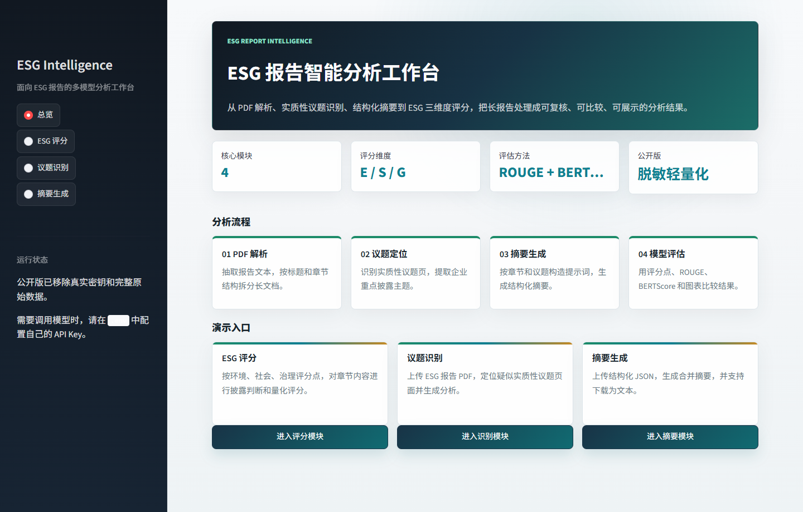
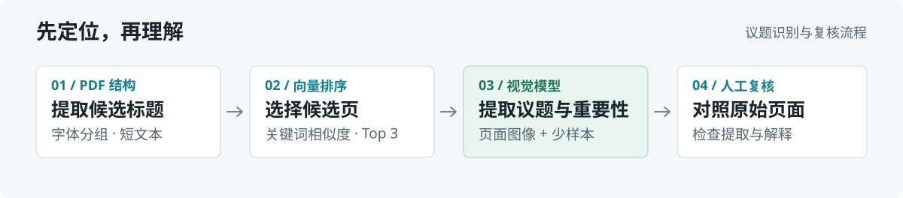

# ESG-Sensor

**把长篇 ESG 报告拆成可检查的议题、摘要与披露评分。**

面向企业 ESG / 可持续发展报告的 Python 分析原型：用 PDF 结构与向量相似度缩小阅读范围，再调用大模型理解议题、生成摘要、辅助评分；通过批量实验脚本比较模型输出。Streamlit 工作台提供三个独立任务入口。

[查看界面](#工作台与真实结果) · [理解机制](#如何处理报告) · [本地运行](#快速开始) · [项目边界](#项目边界)

## 工作台与真实结果



*本地运行当前公开代码的总览截图。界面可在无 API Key 时浏览；模型任务需要自行配置密钥。*

仓库还保留了 **152 份评估 CSV**，包括 DeepSeek、百川、智谱实验的逐章节评语及一份结构化汇总。下面是一条原始记录，展示如何把“摘要好不好”拆成可检查的维度：

OPPO · `ch1.txt` → `c1_summary.txt`：

| 评审维度 | 样例分数 |
| --- | ---: |
| 语义一致性 | 7 |
| 信息覆盖度 | 6 |
| 表达相似性 | 5 |
| 简洁性与冗余度 | 7 |
| 逻辑结构 | 6 |

来源：[百川 / Kimi 评估汇总首条记录](results/baichuan_kimi_evaluation/baichuan_kimi_evaluation_results.csv)。这些是历史模型评审分数，不是人工金标准，也不代表模型整体排名。[查看带解释的评估样例](results/zhipu_evaluation_results/oppo_evaluation_results.csv)。

## 三项核心能力

| 任务与实现 | 输入 → 输出 |
| --- | --- |
| [**实质性议题识别**](app/topic_utils.py) | ESG PDF → 候选页面图像与议题分析 |
| [**章节摘要生成**](app/summary_utils.py) | 章节 / 提示词 JSON → 分段摘要、合并 TXT |
| [**E / S / G 披露评分**](app/score_utils.py) | 章节 TXT 目录 → 各维度总分与正分项平均分 |

评分配置包含环境 **35** 项、社会 **32** 项、治理 **11** 项评分点。当前工作台使用智谱模型；DeepSeek、Kimi、百川等调用保留在独立实验脚本中，界面暂未提供模型切换。

## 如何处理报告



议题识别先按页面字体分组提取短文本作为候选标题，计算它们与议题关键词的 `embedding-3` 向量余弦相似度，以最高三个相似度的均值排序；随后取排名前三的**标题对应页面**，转成图片，结合少样本示例交给 `glm-4v-plus-0111` 分析。标题可能来自同一页，因此不保证得到三个不同页面。

摘要与评分是另两个任务：摘要模块把 JSON 中的每条字符串作为提示词交给 `glm-4-plus`，依次生成并合并文本；评分模块将章节与评分点组合，最多并发 5 个请求，汇总模型返回的分数。

PDF 章节拆分、OCR、摘要实验及评估位于独立目录，**当前工作台还没有把 PDF 上传、章节拆分、摘要和评分串成一次点击的完整流程**。

## 快速开始

### 1. 安装并浏览工作台

```bash
git clone https://github.com/wyww0626-blip/ESG-Sensor.git
cd ESG-Sensor
python -m venv .venv
```

激活环境：Windows PowerShell 使用 `.venv\Scripts\Activate.ps1`，macOS / Linux 使用 `source .venv/bin/activate`。

```bash
python -m pip install -r requirements.txt
cd app
python -m streamlit run main.py
```

从 `app/` 启动可让少样本配置中的 `img/1.png` 等相对路径正确解析。此时可以浏览总览与三个任务页面。

### 2. 运行模型任务

将仓库根目录的 `.env.example` 复制为 `.env`，填写自己的 `ZHIPU_API_KEY`。模型名称写在代码中；需确保账号可访问对应模型。

- **议题识别：** 上传包含可提取文本的 ESG PDF。公开版未包含原始批量 PDF，需自行准备报告。
- **摘要生成：** 上传 UTF-8、无 BOM 的 JSON。格式是“章节名 → 字符串列表”，每个字符串需包含待总结正文及所需指令，例如：

```json
{
  "chapter-1": [
    "请总结以下环境披露，保留原文数字：公司全年用水量为 100 吨，其中回用水为 20 吨。"
  ]
}
```

- **披露评分：** 输入 `../examples/report_chapters`，选择环境、社会、治理或全部。首次运行前需将 `app/score_configs/` 下三个 JSON 保存为 **UTF-8 无 BOM**；当前文件带 BOM，而加载函数使用 `utf-8`，否则会出现 JSON 解析错误。

`examples/material_topics/` 保存的是章节议题标签，适合查看中间数据结构；它们不是包含报告正文的完整摘要输入，且同样带有 BOM，不能直接当作摘要任务的完整示例。

## 实验与结果怎么看

- **有解释的模型评审：** `results/` 按模型保存章节对比及文字评语；[结构化汇总](results/baichuan_kimi_evaluation/baichuan_kimi_evaluation_results.csv) 提供五项维度与总体分数。
- **词面重合度：** [calculate_rouge.py](scripts/calculate_rouge.py) 计算 ROUGE-1 / 2 / L。当前使用默认分词与词干化，中文文本的处理口径仍需改进。
- **语义相似度：** [calculate_bertscore.py](scripts/calculate_bertscore.py) 虽以 BERTScore 命名，实际将文本截取至 3,072 字符，调用 `embedding-3` 后计算整体向量余弦相似度，**不是标准 token 级 BERTScore**。
- **图表脚本：** [heatmap.py](scripts/heatmap.py) 与 [leidatu.py](scripts/leidatu.py) 保留热力图、雷达图实验代码。前者依赖未随公开版提供的汇总 CSV，后者使用脚本中的固定数据；不应直接当作可复现的完整基准测试。

ROUGE 与向量相似度脚本按排序配对文件，并在多样本时去掉最低值后求均值。解读历史结果前，应先核对样本配对、参考文本与统计口径。

## 代码导航

```text
app/               Streamlit 工作台、三个任务实现、78 项评分点、少样本图像
pdf_project/       PDF 字体分析、章节拆分、OCR 与文本还原实验
material_topics/   议题定位、相似度策略、视觉模型与融合实验
scripts/           多模型摘要 / 评分、ROUGE、向量相似度、图表脚本
examples/          章节 TXT / Markdown、议题标签 JSON
results/           历史逐章节评估 CSV 与结构化汇总
assets/readme/     当前界面截图、机制图与本地 README 预览
```

主要依赖：Python、Streamlit、PyMuPDF、智谱 / OpenAI-compatible SDK、pandas、NumPy、scikit-learn、rouge-score、matplotlib、seaborn。完整列表见 [requirements.txt](requirements.txt)；依赖尚未锁定版本。

## 项目边界

- **定位是研究与演示原型。** 未提供独立人工标注集上的准确率、处理时延、成本或线上稳定性结论。历史分数不能替代人工判断。
- **评分是披露启发式。** 每章最多读取 10,000 字符；总分累加章节 × 评分点的正分，同一披露可能被重复计入；平均分只对正分项计算。API / 解析异常在评分函数中会被记为 0，结果尚不能区分失败与未披露。
- **PDF 与实验有前提。** 当前议题入口依赖 PDF 文本层；扫描件 OCR 在独立脚本中。部分脚本仍需调整输入路径、API 配置及补充依赖，公开版未包含大规模原始 PDF、完整参考摘要与中间产物。

阅读建议：先看工作台与一份评估 CSV，再沿着 `topic_utils.py` 的候选标题、相似度排序、视觉分析三步检查实现。
